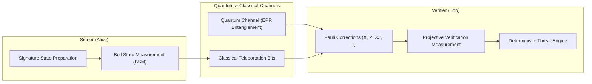

# Architecture & Mathematical Threat Detection Specifications

## 1. System Overview

The system addresses vulnerabilities in teleportation-based Quantum Digital Signature (QDS) protocols using **deterministic, threshold-based statistical threat detection** without Machine Learning or AI.

---

## 2. Teleportation-based Quantum Digital Signature (QDS) Flow

1. **Entanglement Distribution**:
   - Maximally entangled Bell pair $|\Phi^+\rangle = \frac{1}{\sqrt{2}}(|00\rangle + |11\rangle)$ shared between Alice and Bob.
2. **State Preparation**:
   - Alice encodes message bit $m \in \{0, 1\}$ into quantum state $|\psi\rangle = \alpha |0\rangle + \beta |1\rangle$.
3. **Bell Measurement & Classical Correction**:
   - Alice performs joint Bell-state measurement on $|\psi\rangle$ and her half of the EPR pair, yielding 2 classical bits $(b_0, b_1)$.
4. **Pauli Unitary Correction**:
   - Bob applies unitary operator $U \in \{I, X, Z, XZ\}$ conditioned on $(b_0, b_1)$ to reconstruct $|\psi\rangle$.
5. **Projective Measurement & Verification**:
   - Bob performs projective measurements in matching bases $\{|0\rangle, |1\rangle\}$ or $\{|+\rangle, |-\rangle\}$ to verify authenticity.

---

## 3. Threat Vectors & Deterministic Detection Mechanisms

| Threat Vector | Physics / Protocol Phenomenon | Deterministic Detection Metric | Decision Rule |
| :--- | :--- | :--- | :--- |
| **1. Signature Forgery** | Attacker substitutes classical bits or guesses quantum state | State Fidelity $F(\rho, \sigma)$, QBER deviation | $F < F_{\text{threshold}} \implies \text{FORGERY\_DETECTED}$ |
| **2. Impersonation** | Rogue entity transmits forged Bell measurement outcomes | Parity consistency & asymmetric key discrepancy | $\Delta_{\text{parity}} \neq 0 \implies \text{IMPERSONATION\_DETECTED}$ |
| **3. Replay Attacks** | Re-transmission of previous classical/quantum tokens | Non-monotonic session counter / Nonce hash reuse | $\text{Nonce}_{\text{current}} \le \text{Nonce}_{\text{last}} \implies \text{REPLAY\_ATTACK}$ |
| **4. Channel Manipulation** | Intercept-resend, depolarizing noise, phase damping | Quantum Bit Error Rate $\text{QBER} = \frac{N_{\text{err}}}{N_{\text{total}}}$ | $\text{QBER} > \text{QBER}_{\text{threshold}} \implies \text{CHANNEL\_TAMPERED}$ |
| **5. Unauthorized Verification** | Third-party eavesdropping basis or unauthorized measurement | Unallocated Bell index access / basis conflict | $\text{BasisMismatch} \implies \text{UNAUTHORIZED\_ACCESS}$ |

---

## 4. Technology Stack & Component Structure

- **Backend**: Python 3.11+, FastAPI (REST endpoints), Pydantic v2 (Strict validation), SQLAlchemy + SQLite (Persistence), Qiskit (Quantum simulation).
- **Frontend**: React 19, TypeScript, Vite, Tailwind CSS, Recharts (Real-time telemetry and threshold boundary plots).
- **Communication**: JSON REST API with strict CORS and environment variable configuration.
